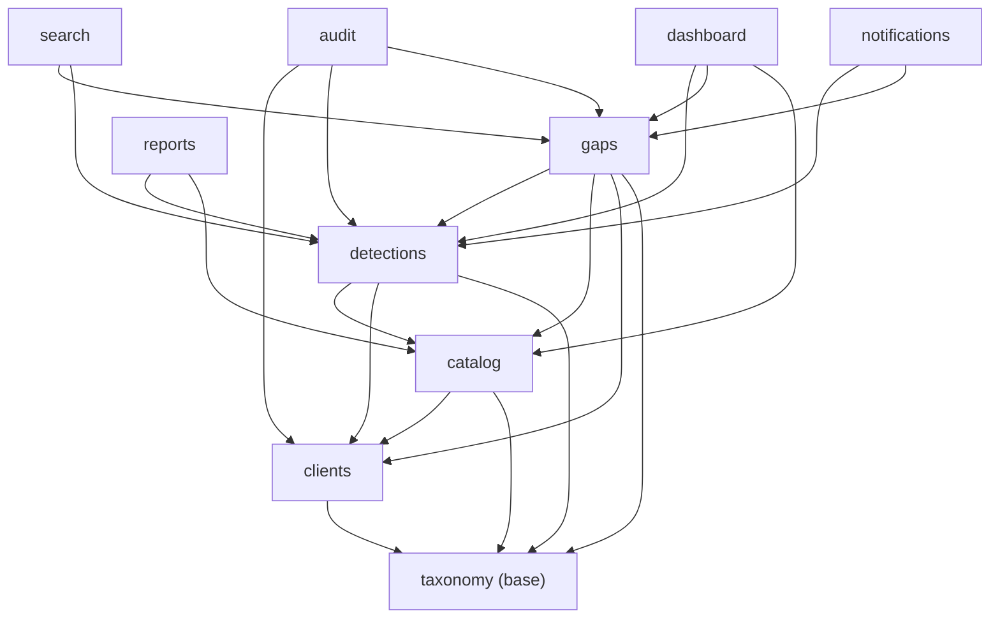

# 01 — Arquitetura

## 1. Visão de infraestrutura

```text
Navegador
   │  HTTP :8088
   ▼
nginx (container "nginx")      → serve /static/ e /media/ direto dos volumes
   │  proxy_pass web:8000         e repassa o resto com X-Real-IP/X-Forwarded-*
   ▼
gunicorn + Django (container "web")   → core.wsgi:application
   │
   ▼
PostgreSQL 16 (container "postgres")  → dados + cache (DatabaseCache)
```

- `docker-compose.yml`: 3 serviços (`postgres`, `web`, `nginx`) e 3 volumes
  (`postgres_data`, `static_volume`, `media_volume`).
- `docker/django/entrypoint.sh`: espera o Postgres, roda `migrate`,
  `setup_roles`, `collectstatic` e sobe o Gunicorn (`GUNICORN_WORKERS`,
  padrão 3). **Todo deploy reaplica migrations e permissões automaticamente.**
- O serviço `web` monta o projeto inteiro (`.:/app`) para que
  `makemigrations` dentro do container grave os arquivos no seu disco. Em
  produção, considere um compose sem esse bind mount (ver README raiz).
- Sem Celery, Redis, filas ou workers. Tudo é calculado em tempo de consulta
  ou por comando de gerenciamento agendado externamente (cron do host).
  **Não introduza infraestrutura nova sem uma necessidade concreta e
  justificada.**

## 2. Stack de aplicação

| Camada | Tecnologia | Observação |
|---|---|---|
| Backend | Django 5.2.6 LTS, Python 3.13 | `requirements.txt` |
| Banco | PostgreSQL 16 | usa recursos específicos: `ArrayField` (`django.contrib.postgres`) |
| Config | `django-environ` | tudo vem do `.env` (modelo em `.env.example`) |
| Estáticos | WhiteNoise + Nginx | ver "Dívidas técnicas" sobre `STATICFILES_STORAGE` |
| Front | Django Templates + Bootstrap 5.3.3 + Bootstrap Icons (CDN) | sem framework JS |
| Gráficos | Chart.js 4.4.4 (CDN, só no dashboard) | |
| Relatórios | ReportLab (PDF), openpyxl (Excel) | app `reports` |
| CSS próprio | `static/css/app.css` | variáveis `--scv-*`, tema claro/escuro |

## 3. Apps Django e responsabilidades

Um app por domínio (*app-per-concern*). `core` é infraestrutura, não tem
modelos.

| App | Responsabilidade | Tem modelos? |
|---|---|---|
| `core` | settings, URLs raiz, utilitários compartilhados (`forms`, `mixins`, `utils`, `context_processors`) | não |
| `accounts` | login com limite de tentativas, logout, comando `setup_roles` (grupos/permissões) | só migration da tabela de cache |
| `taxonomy` | catálogos de configuração (Tecnologia, Status, Severidade, Categoria, Tag, Tipo de Regra, Responsável) + Frameworks/Controles + export ATT&CK Navigator | sim |
| `clients` | Cliente | sim |
| `catalog` | catálogo global de Fontes de Log e Casos de Uso + vínculo por cliente + Templates de Implementação + cálculo de cobertura | sim |
| `detections` | Regras, filtros, colunas configuráveis, importação CSV, verificações de inconsistência | sim |
| `gaps` | Gaps de monitoramento | sim |
| `audit` | Histórico de alterações via signals | sim |
| `dashboard` | indicadores agregados, gráficos, Cyber Kill Chain | não |
| `search` | busca global multi-entidade | não |
| `reports` | relatório por cliente em PDF/Excel | não |
| `notifications` | digest por e-mail (comando `send_digest`) | não |

## 4. Dependências entre apps (camadas)

As setas indicam "importa de". A regra é: **um app só importa, em nível de
módulo, de apps em camadas abaixo dele.** Isso evita import circular e
mantém o acoplamento previsível.



Camadas, de baixo para cima:

1. `core` (utilitários) e `taxonomy` (catálogos)
2. `clients`
3. `catalog`
4. `detections`
5. `gaps`
6. Consumidores somente-leitura / transversais: `audit`, `dashboard`,
   `search`, `reports`, `notifications`

**Quando uma camada baixa precisa exibir dado de uma camada alta** (ex.: a
página de detalhe do Cliente mostra cobertura de `catalog`, inconsistências
de `detections` e histórico de `audit`), o import é feito **dentro do
método**, não no topo do arquivo. Exemplos existentes:

- `clients/views.py::ClientDetailView.get_context_data` — importa
  `catalog`, `detections` e `audit` localmente.
- `taxonomy/views.py::FrameworkDetailView` / `FrameworkNavigatorExportView`
  — importam `clients.models.Client` localmente.
- `detections/services.py` — importa `catalog.models` dentro das funções.

Siga o mesmo padrão. Se você sentir necessidade de importar "para cima" no
topo do módulo, é sinal de que a lógica está no app errado.

## 5. Padrões obrigatórios do código

### 5.1 Onde cada coisa mora

| Arquivo | Conteúdo | Não deve conter |
|---|---|---|
| `models.py` | estrutura de dados, `Meta`, `__str__`, defaults triviais | regra de negócio que consulta outras tabelas |
| `services.py` | **toda** regra de negócio e agregação (cobertura, inconsistências, import CSV, dashboard, relatório, digest) | acesso a `request`, renderização |
| `forms.py` | validação de entrada e **filtragem de opções** (status por escopo, categoria por `applicable_to`) | lógica de negócio |
| `views.py` | permissão, ler parâmetros, chamar service, montar contexto | cálculos de negócio |
| `templates/<app>/` | apresentação | consultas ao banco além de acessar relações já carregadas |
| `management/commands/` | tarefas agendadas/administrativas finas que delegam para services | lógica duplicada de services |

Exemplo canônico: `reports/services.py::build_client_report` monta os dados;
`reports/pdf.py` e `reports/excel.py` só renderizam; `reports/views.py` só
amarra permissão + resposta HTTP.

### 5.2 Views

- Class-based views genéricas do Django (`ListView`, `DetailView`,
  `CreateView`, `UpdateView`, `DeleteView`, `FormView`, `View`).
- Toda view protegida usa **`LoginRequiredMixin` + `PermissionRequiredMixin`**
  com `permission_required = "<app>.<ação>_<model>"`. Exceções
  conscientes: `dashboard` e `search` exigem só login (a busca filtra por
  permissão categoria a categoria).
- Listagens expõem `can_add` / `can_change` / `can_delete` no contexto para
  o template esconder botões. **Esconder botão não é segurança** — a view
  de destino sempre checa a permissão de novo.
- Delete de modelo referenciado por FK `PROTECT` usa
  `core.mixins.ProtectedDeleteMixin` (mostra mensagem em vez de erro 500).
- Recursos aninhados em um pai (ex.: `ClientLogSource` dentro de `Client`)
  usam um *FormMixin* que resolve o pai no `dispatch` e injeta no form
  (`catalog/views.py::ClientLogSourceFormMixin`, `taxonomy/views.py::FrameworkControlFormMixin`).

### 5.3 Forms

- Sempre herdar de `core.forms.BootstrapModelForm` (aplica as classes CSS do
  Bootstrap automaticamente; campo chamado `color` vira seletor de cor).
- **Filtrar opções de Status por escopo** e manter o valor atual mesmo se
  inativo:

  ```python
  self.fields["status"].queryset = Status.objects.filter(
      Q(scope__contains=[StatusScope.RULE]) & Q(is_active=True)
      | Q(pk=self.instance.status_id)
  )
  ```

- Categorias filtradas por `applicable_to__contains=[CategoryScope.X]`.
- O banco **não** impede um Status de escopo errado (é um `ArrayField`, sem
  CHECK); quem garante é o form. Ver teste
  `clients/tests.py::ClientModelTests::test_status_with_wrong_scope...`.

### 5.4 Parâmetros de URL e entrada

- Todo ID vindo de querystring passa por `core.utils.parse_int_or_none`
  antes de ir ao ORM (evita 500 com `?client=abc`).
- Redirecionamento para URL vinda do usuário (`next`) só depois de
  `url_has_allowed_host_and_scheme` (ver `detections/views.py::RuleColumnPreferenceUpdateView`).
- Uploads: validar extensão no form e **limitar volume** (ver
  `MAX_CSV_ROWS` em `detections/services.py`).

### 5.5 Status e semântica

`Status.name` é texto livre do administrador. A lógica de negócio **só** lê
`Status.category` (`taxonomy.choices.StatusCategory`): `ACTIVE`, `TESTING`,
`COVERED`, `NOT_RECEIVING`, `CLOSED` etc. Nunca escreva
`status.name == "Ativo"`.

### 5.6 Interface

- Todo template estende `base.html` e preenche ``.
- Ícones: Bootstrap Icons (`<i class="bi bi-...">`), nunca emoji.
- Cores: variáveis `--scv-*` de `static/css/app.css` ou classes Bootstrap
  já estilizadas; nunca hex fixo. Exceção: badges de Status/Severidade usam
  a cor **cadastrada no catálogo** (`style="background-color: {{ obj.color }}"`).
- Busca sempre visível; filtros secundários atrás de "Filtros avançados".
- Item ativo da sidebar é calculado por `core/context_processors.py::active_nav`
  a partir do `app_name`/`url_name` — nenhuma view precisa informar.

## 6. Ciclo de uma requisição

```text
Nginx → Gunicorn → MIDDLEWARE (core/settings.py, em ordem):
  SecurityMiddleware → WhiteNoise → Session → Common → Csrf
  → Authentication → audit.CurrentUserMiddleware (guarda request.user numa thread-local)
  → Messages → XFrameOptions
→ core/urls.py → <app>/urls.py → View
   → LoginRequired / PermissionRequired
   → Form (validação + filtragem de opções)
   → services.py (regra de negócio)
   → model.save()  ──► signals do audit gravam AuditLog na mesma transação
→ Template (base.html + context processor active_nav) → resposta
```

## 7. Autenticação, autorização e papéis

- Autenticação nativa do Django. Login em `/login/`
  (`accounts/views.py::ThrottledLoginView`): após 10 falhas em 15 min **por
  IP** (header `X-Real-IP` do Nginx), bloqueia. Contador guardado no
  `DatabaseCache` (tabela `django_cache`) para ser compartilhado entre
  workers.
- Autorização por **permissões de model do Django** agrupadas em 4 grupos,
  criados/atualizados por `python manage.py setup_roles`
  (`accounts/management/commands/setup_roles.py`):

| Grupo | `taxonomy` (configuração) | `clients`, `catalog`, `detections`, `gaps` (operacional) | `audit` |
|---|---|---|---|
| ADMIN | tudo | tudo | tudo (mas o admin bloqueia edição) |
| SOC_MANAGER | — | view/add/change/delete | view |
| ANALYST | — | view/add/change | view |
| VIEWER | view | view | view |

- Os escopos são definidos por **listas de apps** (`CONFIG_APPS`,
  `OPERATIONAL_APPS`, `READ_ONLY_APPS`), não por lista de models: um model
  novo em um app já listado herda as permissões automaticamente na próxima
  execução de `setup_roles`. Um **app novo** precisa ser adicionado a uma
  dessas listas.
- Não existe isolamento por cliente: quem tem `view_client` vê todos os
  clientes (decisão de produto pendente — ver README raiz, seção Segurança).

## 8. Auditoria (como funciona por baixo)

- `audit/signals.py` escuta `pre_save`, `post_save`, `pre_delete`,
  `post_delete` e `m2m_changed` para os models em `TRACKED_MODELS`
  (`Client`, `Rule`, `Gap`). Registrado em `audit/apps.py::ready()`.
- Usuário vem de `audit.middleware.get_current_user()` (thread-local
  preenchida pelo middleware). Fora de requisição (shell, comando) fica
  `None`.
- `pre_save` tira snapshot do registro no banco; `post_save` compara e grava
  só os campos alterados em `AuditLog.changes` (`{campo: [antigo, novo]}`).
- M2M rastreados por `TRACKED_M2M_FIELDS`.
- `AuditLog.client` é desnormalizado para a aba "Histórico" do cliente
  continuar funcionando depois que a regra/gap for excluída.
- **Limitações importantes** (signals não disparam):
  `QuerySet.update()`, `bulk_create()`, `bulk_update()`, SQL cru e
  `loaddata` (`raw=True` é ignorado de propósito). Se você usar operações em
  massa em um model rastreado, o histórico **não** será gravado.
- `_pending_snapshots` e `_clients_being_deleted` são estado em memória por
  processo. Funciona com Gunicorn síncrono (processos); se um dia migrar para
  ASGI/threads, revise.

## 9. Dívidas técnicas e pontos de atenção conhecidos

Levantados durante a escrita desta documentação. Não foram corrigidos — são
itens para priorizar.

| # | Ponto | Onde | Impacto |
|---|---|---|---|
| 1 | `STATICFILES_STORAGE` foi **removido no Django 5.1**; no 5.2 a configuração é ignorada e o storage comprimido/manifest do WhiteNoise não está ativo. O correto é `STORAGES = {"staticfiles": {"BACKEND": "whitenoise.storage.CompressedManifestStaticFilesStorage"}, "default": {...}}`. | `core/settings.py` | Baixo (Nginx serve os estáticos), mas sem cache-busting por hash. |
| 2 | `GapForm` usa o `client` vindo de `?client=` / POST direto num `.filter(client_id=...)` sem `parse_int_or_none` — `/gaps/novo/?client=abc` tende a gerar erro 500, o mesmo tipo de falha já corrigido em outras telas. | `gaps/forms.py`, `gaps/views.py::GapCreateView.get_initial` | Médio (crash com URL malformada). |
| 3 | Comentário em `AVAILABLE_RULE_COLUMNS` cita `_rule_columns.html`, que não existe; as colunas são renderizadas por um `if/elif` em `detections/templates/detections/rule_list.html`. | `detections/models.py` | Documentação enganosa. |
| 4 | N+1: `rule_is_possibly_inoperative` faz 1 consulta por regra na listagem (até 25 por página) e no relatório (todas as regras do cliente). | `detections/views.py`, `reports/services.py` | Desempenho em clientes grandes. |
| 5 | O dashboard encontra a Kill Chain pelo **nome** exato `"Cyber Kill Chain"`; renomear o framework faz o widget sumir. | `dashboard/services.py` | Baixo. |
| 6 | Itens de menu "Campos personalizados" (Fase 8) e "Usuários" estão desabilitados — gestão de usuários hoje é pelo Django Admin. | `templates/base.html` | Funcional. |
