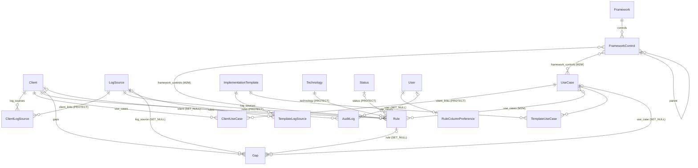

# 02 — Modelo de dados

## 1. Diagrama geral

Catálogos de `taxonomy` (Status, Severity, Category, Tag, Technology,
RuleType, ResponsibleParty) foram simplificados no diagrama: quase toda
entidade aponta para eles.



## 2. Padrão "catálogo global × implementação por cliente"

É o padrão estrutural mais importante do sistema:

```text
LogSource  (existe 1 vez: "Windows Security")
  └── ClientLogSource (client, log_source, status, último evento)   unique(client, log_source)

UseCase    (existe 1 vez: "UC-001 Brute Force")
  └── ClientUseCase   (client, use_case, status, criticidade, responsável)   unique(client, use_case)
```

- O catálogo global define **o que é** a coisa; o vínculo por cliente define
  **a situação dela naquele cliente**.
- Vínculos são editados na página do cliente (não têm listagem própria).
- Excluir item do catálogo em uso é bloqueado (`PROTECT`) — a view usa
  `ProtectedDeleteMixin` para avisar quem está usando.
- `ImplementationTemplate` agrupa LogSources + UseCases para criar vários
  vínculos de uma vez (`catalog/services.py::apply_template_to_client`,
  idempotente via `get_or_create`).

Ao criar uma entidade nova que "existe de forma genérica mas tem estado por
cliente", **reaproveite este padrão** em vez de inventar outro.

## 3. Entidades

### 3.1 `taxonomy` — catálogos de configuração

`ConfigurableOption` (abstrato) — base de Technology, Status, Severity,
Category, Tag, RuleType, ResponsibleParty:

| Campo | Tipo | Nota |
|---|---|---|
| `name` | Char(100) | texto exibido |
| `code` | Slug(60), único | gerado do `name` no `save()` se vazio |
| `description`, `icon` | texto | |
| `color` | Char(7) | hex; usado nos badges |
| `order` | int | ordenação (`Meta.ordering = ["order", "name"]`) |
| `is_active` | bool | inativo some das opções novas, mas continua nos registros que já o usam |
| `created_at`, `updated_at` | datetime | |

Campos extras:

| Model | Campo extra | Uso |
|---|---|---|
| `Technology` | `category` → Category (`applicable_to` ∋ TECHNOLOGY) | agrupamento |
| `Status` | `scope: ArrayField[StatusScope]` | em quais entidades o status aparece |
| `Status` | `category: StatusCategory` | **semântica usada pela lógica de negócio** |
| `Severity` | `weight` | ordenação/indicadores |
| `Category` | `applicable_to: ArrayField[CategoryScope]` | em quais catálogos a categoria aparece |
| `ResponsibleParty` | `is_client: bool` | marca o responsável que representa o cliente; o relatório para o cliente usa isso para listar "ações pendentes do seu lado" |

`Framework` (nome único, versão, URL) → `FrameworkControl` (`code` único por
framework, `parent` opcional para sub-técnicas). Usado para MITRE ATT&CK
(`seed_mitre_attack` semeia as 14 táticas de topo; técnicas entram como
filhas, à mão), Cyber Kill Chain (`seed_kill_chain`) e qualquer outro
framework. `taxonomy/services.py::framework_layers` agrupa os controles de
topo (sem `parent`) com todos os descendentes - é a base do widget de
camadas do Dashboard e da seção "Camadas de ataque protegidas" do
relatório para o cliente (`03-funcionalidades.md §2` e `§9`).

### 3.2 Enums fixos — `taxonomy/choices.py`

Mudam só com deploy, porque a lógica depende deles.

**`StatusScope`**: `CLIENT`, `RULE`, `CLIENT_USE_CASE`, `CLIENT_LOG_SOURCE`, `GAP`.

**`StatusCategory`** e quem a interpreta:

| Categoria | Usada em | Lido por |
|---|---|---|
| `ACTIVE` | Regra, Cliente | inoperância, inconsistência de cobertura, dashboard, relatório |
| `INACTIVE`, `TESTING`, `IN_REVIEW` | Regra | cards do dashboard |
| `PENDING_EXTERNAL` | genérico | (sem lógica atrelada) |
| `COVERED`, `PARTIAL`, `NOT_COVERED` | ClientUseCase | cálculo de cobertura, dashboard |
| `NOT_APPLICABLE` | ClientUseCase | **excluído** do denominador da cobertura |
| `RECEIVING`, `NOT_RECEIVING`, `NOT_INTEGRATED` | ClientLogSource | inoperância, card "fontes sem dados" |
| `OPEN`, `CLOSED` | Gap | "gaps em aberto" = tudo que **não** é `CLOSED` |
| `GENERIC` | qualquer | nenhuma semântica |

**`CategoryScope`**: `TECHNOLOGY`, `USE_CASE`, `RULE`, `LOG_SOURCE`.

### 3.3 `clients.Client`

`name`, `legal_name`, `status` (PROTECT, escopo CLIENT), `notes`. Raiz de
quase tudo: excluir um cliente **apaga em cascata** suas regras, gaps e
vínculos de fonte/caso de uso.

### 3.4 `catalog`

| Model | Campos principais | Restrições |
|---|---|---|
| `LogSource` | `name` (único), `description`, `category`, `technology`, `tags`, `is_active` | |
| `ClientLogSource` | `client` (CASCADE), `log_source` (PROTECT), `status` (escopo CLIENT_LOG_SOURCE), `last_event_at`, `notes` | `unique(client, log_source)` |
| `UseCase` | `code` (único, ex. UC-001), `name`, `description`, `objective`, `category`, `threat`, `protects`, `tags`, `framework_controls`, `notes`, `is_active` | |
| `ClientUseCase` | `client` (CASCADE), `use_case` (PROTECT), `status` (escopo CLIENT_USE_CASE), `criticality` → Severity, `owner` → User, `last_validated_at`, `notes` | `unique(client, use_case)` |
| `ImplementationTemplate` | `name` (único), `description`, `is_active` | |
| `TemplateLogSource` | `template`, `log_source` | `unique(template, log_source)` |
| `TemplateUseCase` | `template`, `use_case`, `default_criticality` | `unique(template, use_case)` |

### 3.5 `detections`

`Rule`:

| Campo | Nota |
|---|---|
| `internal_id` | **único**, digitado manualmente; chave de casamento da importação CSV |
| `vendor_rule_id` | ID na ferramenta de origem |
| `client` | CASCADE |
| `technology` | **obrigatório**, PROTECT |
| `rule_type`, `category` | SET_NULL |
| `log_source` | PROTECT, opcional — base da verificação de inoperância |
| `original_level` | texto livre (nível nativo do vendor) |
| `severity` | "Severidade SOC", PROTECT |
| `status` | escopo RULE, PROTECT |
| `use_cases`, `framework_controls`, `tags` | M2M |
| `last_reviewed_at`, `next_review_at` | `next_review_at < hoje` ⇒ revisão pendente |
| `protects`, `threat`, `description`, `objective`, `notes` | texto |

Índices: `(client, status)` e `next_review_at`.

`RuleColumnPreference`: 1 por usuário, `visible_columns: ArrayField`.
`AVAILABLE_RULE_COLUMNS` / `DEFAULT_RULE_COLUMNS` ficam em
`detections/models.py`.

### 3.6 `gaps.Gap`

`code` (único, manual), `client` (CASCADE), `title`, `description`,
`impact`, `criticality` → Severity, `responsible_party` → ResponsibleParty,
`status` (escopo GAP, PROTECT), `recommendation`, `opened_at` (padrão hoje),
`closed_at`, `notes`, e vínculos **opcionais e fracos** (SET_NULL) com
`log_source`, `use_case`, `rule`; `tags` (M2M).

### 3.7 `audit.AuditLog`

`timestamp`, `user`, `action` (CREATE/UPDATE/DELETE), `app_label`,
`model_name`, `object_id` (string), `object_repr`, `client` (desnormalizado),
`changes` (JSON). Somente leitura por design.

## 4. Política de `on_delete` (resumo)

| Situação | Regra usada | Motivo |
|---|---|---|
| Filho pertence ao cliente (Rule, Gap, ClientX) | `CASCADE` | sem cliente, o registro não faz sentido |
| Item de catálogo referenciado (Status, Technology, LogSource, UseCase, Severity na Regra) | `PROTECT` | preservar integridade; usuário precisa reclassificar antes |
| Classificação opcional (Category, RuleType, criticality, owner, ResponsibleParty) | `SET_NULL` | perder a classificação não invalida o registro |
| Referência leve do Gap (rule, use_case, log_source) | `SET_NULL` | Gap nunca some por causa do que só citava |
| Itens de template | `CASCADE` | só existem dentro do template |

Ao adicionar FK nova, escolha conscientemente uma destas categorias e, se
for `PROTECT`, use `ProtectedDeleteMixin` na DeleteView do model alvo.

## 5. Migrations

- Ficam em `<app>/migrations/`. Gere com `makemigrations` **dentro do
  container** (ver `05-operacao-e-testes.md`) e versione o arquivo.
- Mudar `choices` de um enum em `taxonomy/choices.py` gera migration (o
  Django registra `choices` no campo) — normal, versione.
- Nunca edite migration já aplicada em produção; crie uma nova.
